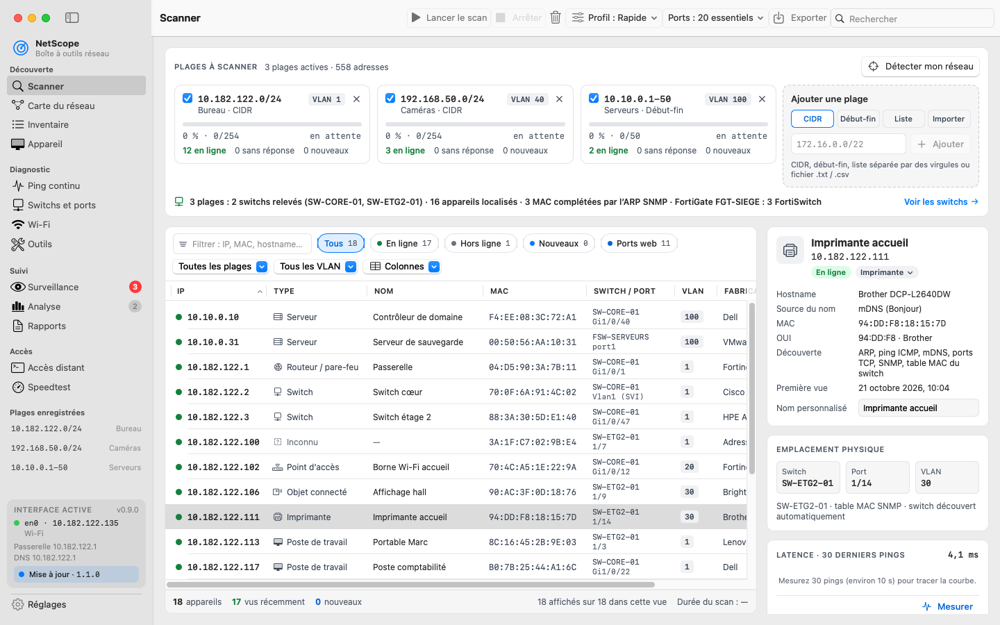

# NetScope

Application macOS native pour le technicien réseau : découverte des appareils sur plusieurs
plages, emplacement physique (switch et port), diagnostic (ping continu, Wi-Fi, outils),
surveillance, rapports et accès distant, le tout en français.



## Fonctions

Version 0.9.0 : les quatorze écrans fonctionnent, au style Mac (mode sombre, petite fenêtre), avec des tableaux à colonnes réglables. Nouveau dans la 0.9.0 : les FortiSwitch gérés par une FortiGate (FortiLink) sont lus par l’API REST de la FortiGate, en lecture seule (jeton au Trousseau), et remplissent Switchs et ports ainsi que les colonnes Switch / Port et VLAN du Scanner, même si le réseau FortiLink n’est pas joignable depuis le Mac. Depuis la 0.8.0 : des Réglages complets (notifications choisies avec heures « Ne pas déranger », raccourcis modifiables et menus Scan, Appareil et Aller, sauvegarde automatique avec restauration, test SNMP v2c/v3, identifiants SSH et WMI, méthodes de découverte par profil) et des alertes hors du Mac par courriel et webhook Teams, Slack ou JSON. Depuis la 0.7.0 : « Capture de paquets » façon Wireshark (filtres, détail par couche, vue hexadécimale, suivi de flux, statistiques, .pcap) et « Vitesse des disques » (disques internes et externes, partages réseau, dossiers nuage) dans la Boîte à outils. Depuis la 0.6.0 : « État des services » (Microsoft 365, Azure, Apple, AWS, Google, Cloudflare… vus par leur page officielle et testés depuis votre réseau) et un groupe « Courriel » dans la Boîte à outils (santé d’un domaine sur 100, MX, listes noires, SPF/DKIM/DMARC, diagnostic SMTP, analyse d’en-têtes), avec une Recherche DNS plus complète (SOA, SRV, CAA, DNSSEC, comparaison et propagation). La suite prévue est dans
[docs/A-FAIRE.md](docs/A-FAIRE.md).

- **Scanner multi-plages qui se remplit tout seul** : plusieurs plages à la fois, ping ICMP
  sans droits administrateur, table ARP, noms d’hôte (DNS inverse, mDNS/Bonjour, NetBIOS,
  sysName SNMP, avec leur source), 20 ports essentiels sondés à chaque scan, fabricant, type
  d’appareil ; étapes visibles (Ping → Table ARP → Noms et ports → Switchs (SNMP) →
  Emplacements), filtres, tri, panneau de détail, export CSV.
- **Fabricants d’après le registre IEEE complet** : environ 53 700 préfixes MAC (MA-L, MA-M
  et MA-S, plus long préfixe d’abord) fournis avec l’application ; Réglages › Général › Base
  des fabricants affiche la source et met la base à jour depuis l’IEEE, seulement sur demande.
- **Découverte automatique des switchs** (activée par défaut) : pendant chaque scan,
  NetScope interroge en SNMP v2c lecture seule les appareils en ligne aux adresses privées
  (jamais vers Internet ; communauté des
  Identifiants, puis « public » ou la liste de Réglages › Switchs), ajoute les switchs qui
  répondent, relève leurs tables MAC, complète les MAC des autres VLAN par l’ARP SNMP de la
  passerelle et des switchs de niveau 3, puis remplit les colonnes **Switch / Port** et
  **VLAN** de chaque appareil. Un switch retiré à la main n’est plus interrogé (« Ne plus
  ignorer » dans Réglages › Switchs). Limite : mDNS ne répond pas d’un VLAN à l’autre ; sur
  les autres VLAN, les noms viennent du DNS inverse, de NetBIOS (Windows) et du sysName SNMP.
- **Surveillance** : sondes Ping, TCP, HTTP(S) (certificat qui expire, mot-clé), DNS, SNMP,
  port de switch et nouveaux appareils, avec seuils, plage horaire et dépendance ; barre de
  disponibilité 24 h, journal des alertes, notifications macOS et **icône dans la barre de
  menus** ; les sondes continuent fenêtre fermée.
- **Rapports** : rapport client en **PDF** (format lettre, « Page N de M », signature),
  quatre modèles, sections tirées du scan, de l’inventaire, des switchs et du Wi-Fi ; exports
  CSV, JSON et HTML ; brouillon Mail avec le PDF joint (rien n’est envoyé sans toi).
- **Test DHCP** : tous les serveurs DHCP qui répondent, avec leur offre, et alerte si un
  serveur n’est pas autorisé (jamais de bail accepté).
- **Capture LLDP/CDP** : le switch, le port, le VLAN et le PoE où ce Mac est branché, sans
  SNMP. Il faut l’accès BPF (ChmodBPF de Wireshark) ou l’autorisation d’administrateur de
  macOS, demandée une fois par capture.
- **Ping continu** multi-cibles (intervalle, taille de paquet pour le test MTU), statistiques
  (min, moyenne, max, gigue, perte, P95), graphes, journal des coupures, **traceroute et MTR**.
- **Switchs et ports** : client SNMP v2c intégré (table MAC BRIDGE-MIB / Q-BRIDGE-MIB, LLDP,
  interfaces, PoE) pour savoir **sur quel port de quel switch** chaque appareil est branché ;
  switchs découverts automatiquement ou ajoutés à la main, façade du switch dessinée,
  recherche par IP ou MAC ; **FortiSwitch gérés par une FortiGate** lus par l’API REST de la
  FortiGate (Réglages › Switchs › Contrôleur FortiGate, lecture seule, empreinte du certificat
  acceptée une fois, aide pour créer l’administrateur API).
- **Wi-Fi** : connexion actuelle (RSSI, bruit, SNR, canal, débit), analyse des réseaux
  voisins, graphe des canaux 2,4 / 5 / 6 GHz, recommandations.
- **Fiche appareil** : réseau, matériel, emplacement physique, ports et services avec
  bannières, sonde web, notes.
- **Boîte à outils** : calculateur de sous-réseaux avec découpage, convertisseur MAC/OUI,
  scan de ports, DNS (A, AAAA, MX, PTR, TXT, NS, CNAME), Whois, Wake-on-LAN.
- **Inventaire permanent** : tous les appareils jamais vus, champs éditables (local, prise,
  responsable…), chronologie des changements (IP, port de switch, hors ligne), import et
  export CSV.
- **Analyse** : indicateurs, carte d’occupation de la plage, répartition par fabricant et par
  type, alertes (nouvel appareil, conflit IP…), comparaison de deux scans.
- **Carte du réseau** construite à partir du scan (passerelle, switchs, groupes d’appareils).
- **Accès distant** : connexions SSH, Telnet, console série, RDP et VNC enregistrées par site,
  ouvertes dans Terminal, Windows App ou Partage d’écran ; import depuis le scan ; RDP et VNC
  **en fenêtre ou en plein écran** (taille de la fenêtre RDP, « Tous les écrans »).
- **Speedtest** : débit Internet (multi-flux, latence au repos et en charge, gigue) par
  Cloudflare, M-Lab (NDT7), LibreSpeed ou Ookla (si son outil officiel est installé), choix du
  serveur (automatique, favoris, personnalisé), débit local avec iperf3, historique comparé par
  serveur ; bouton « Installer » (Homebrew, dans Terminal) pour iperf3, telnet et Ookla.
- **Ressources** : processeur, mémoire et débit des interfaces de ce Mac (sans trafic) et des
  appareils SNMP (HOST-RESOURCES-MIB, Cisco, Fortinet, HPE, IF-MIB), ports les plus chargés
  d’un switch, courbes des 5 dernières minutes, export CSV, tuile dans la barre de menus et
  sondes de Surveillance.
- **PoE** : « Suis-je sur un port PoE ? » pour ce Mac (capture LLDP/CDP), PoE de chaque port
  de switch (watts réels sur Cisco et HPE/Aruba) et colonne « PoE » du Scanner.
- **Mise à jour automatique** depuis les Releases GitHub (canal Stable ou Bêta, vérification
  de la signature avant installation), menu « Rechercher les mises à jour… ».
- Barre latérale à quatorze écrans, fidèle aux croquis.
- Interface active affichée en bas de la barre latérale (« en0 · 10.182.122.135 · Wi-Fi »),
  avec la version et une pastille quand une mise à jour est disponible.
- Recherche globale par IP, MAC, nom, fabricant ou port de switch.
- Plages à scanner sous toutes les formes courantes : `10.182.122.0/24`, `192.168.1.1-254`,
  `10.10.0.1-10.10.0.50`, `10.0.0.5`, ou une liste ; limite de sécurité de 65 536 adresses.
- Calculateur de sous-réseaux : réseau, masque, masque inverse, broadcast, premier et dernier
  hôte, nombre d’hôtes, classe, privé ou public, masque en binaire, découpage.
- Reconnaissance des adresses MAC privées (aléatoires).
- Au premier lancement, la plage proposée est celle du réseau de l’interface active.
- Plages enregistrées et noms personnalisés conservés d’un lancement à l’autre.

## Installer

Télécharge [NetScope.dmg](https://github.com/mdany75/NetScope/releases/latest/download/NetScope.dmg)
(toujours la dernière version), ouvre-le et glisse NetScope dans Applications.

Configuration requise : macOS 14 ou plus récent. Au premier scan, macOS demande l’accès au
réseau local ; pour lire le nom des réseaux Wi-Fi, il demande aussi la localisation (bouton
« Autoriser la localisation » de l’écran Wi-Fi). La Surveillance demande l’autorisation des
notifications, et le plein écran VNC celle de l’Accessibilité.

## Reconstruire

Outils de ligne de commande Xcode (Swift 6 ou plus récent). Aucune dépendance externe.

```bash
./build.sh            # produit build/NetScope.dmg
./build.sh --install  # remplace aussi /Applications/NetScope.app
```

Captures de chaque écran, hors écran, avec les données de démonstration des croquis :

```bash
swift build && ./.build/debug/NetScope --snapshot /tmp/netscope-snap --demo
```

## Tests

```bash
swift build && ./.build/debug/NetScopeSelfTest
```

Les tests portent sur le moteur (adresses, plages, sous-réseaux, MAC, fabricants, scan, ping, SNMP, DNS, mise à jour, inventaire, Speedtest, accès distant, DHCP, LLDP/CDP, surveillance, rapports). Ils
n’envoient rien sur le réseau : aucun scan, aucune requête, sauf éventuellement vers 127.0.0.1.

## Organisation

- `Sources/NetScopeCore/` : moteur réseau sans interface (Foundation, Network, Darwin), un
  dossier par module (`Addressing/`, `Hardware/`, `Models/`, `System/`…)
- `Sources/NetScope/` : application SwiftUI ; `Theme.swift`, `Sidebar.swift`, `AppState.swift`,
  `Shared/Components.swift`, un fichier par écran dans `Screens/`, outils de développement dans
  `DevTools/` (captures, démonstration)
- `Sources/NetScopeSelfTest/` : tests du moteur (exécutable, sans XCTest)
- `scripts/make-icon.swift` : dessine l’icône (radar bleu sur fond bleu nuit)
- `scripts/make-oui.py` : convertit le registre IEEE (oui.csv, mam.csv, oui36.csv) en
  `Resources/oui.tsv` ; ses règles de noms courts sont aussi écrites en Swift
  (`OUIRegistry.swift`) et vérifiées sur les mêmes exemples (`scripts/oui-name-examples.tsv`)
- `Resources/oui.tsv` : base des fabricants (« préfixe<TAB>nom », une donnée, pas un fichier
  produit), copiée dans l’application par `build.sh`
- `Resources/Info.plist` : identité de l’application et autorisations (réseau local, Bonjour, localisation)
- `docs/capture.png` : capture de la fenêtre
- `docs/A-FAIRE.md` : notes d’essai et suite prévue ; `docs/feuille-de-route.html` : feuille de route
- `docs/croquis/` : croquis de conception des quatorze écrans (`Main.dc.html` pour le Scanner,
  `Ping.dc.html`, `Switch.dc.html`…, et `canvas.json` qui les assemble) ; ils font foi pour la
  disposition, les couleurs, la densité et les libellés
- `build.sh` : construction, signature, image disque, installation
